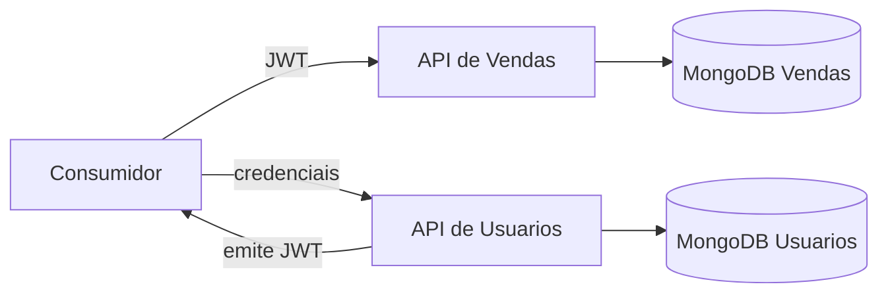

# Arquitetura

Cada API segue Clean Architecture: `Domain`, `Application`, `Infrastructure` e `Api`. A dependência aponta para dentro. A API de Vendas não consulta nem usa a collection da API de Usuarios. O JWT é o contrato de identidade entre os serviços.

Configurações são fornecidas por ambiente: connection string própria, emissor, audiência e segredo JWT. Nenhum segredo é versionado.
