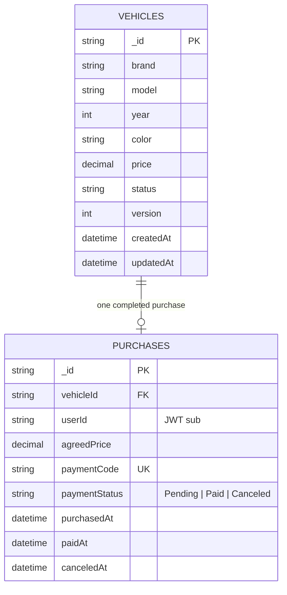

# Modelo MongoDB — Vendas

Índices: `vehicles { status: 1, price: 1, _id: 1 }`, `purchases { vehicleId: 1 }` único, `purchases { paymentCode: 1 }` único, e `purchases { userId: 1, purchasedAt: -1 }`. A confirmação usa filtro condicional em veículo disponível e versionamento otimista.
