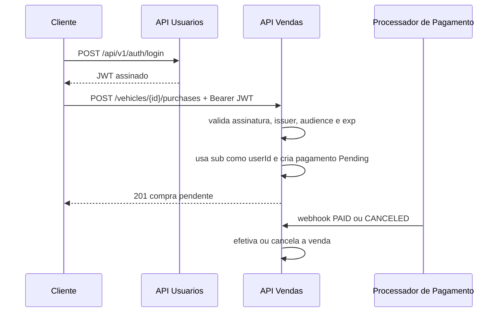

# Integração entre APIs



Falhas de token retornam 401. A API de Vendas não faz chamada síncrona à API de Usuarios para validar token; isso reduz acoplamento e mantém operação disponível enquanto o token for válido.
# Testes de integração do ambiente Docker

O teste `RoleAuthorizationIntegrationTests` executa contra as APIs reais do Compose: Vendas em `http://localhost:8180` e Usuários em `http://localhost:8181`. Ele não inicia containers para não alterar o ciclo de vida do ambiente do desenvolvedor.

Antes da execução:

```powershell
docker compose -f compose.yaml -f compose.local-ports.yaml up -d --build
dotnet test Fiap.RevendaVeiculos.slnx --filter "Category=Docker"
```

Se os health checks não responderem, o teste falha com instrução explícita para iniciar o Compose.

## Matriz de cobertura

| Contexto | Validação |
| --- | --- |
| Usuários | Cadastro e login de `ADM` e `COMPRADOR`; JWT emitido para cada papel. |
| Vendas — ADM | Criação, consulta e edição de veículo. |
| Vendas — comprador | Consulta/listagem permitida; criação retorna `403 Forbidden`; compra é permitida. |
| Pagamento | Webhook autenticado `PAID` finaliza venda e inclui veículo na listagem de vendidos. |
| Cancelamento | Webhook autenticado `CANCELED` libera novamente o veículo. |

O CI central não executa essa categoria, pois sua simulação usa `docker compose up --no-start`. Ele executa os testes não-Docker e valida que os quatro containers são criados. A categoria Docker deve ser executada localmente com os serviços ativos.

