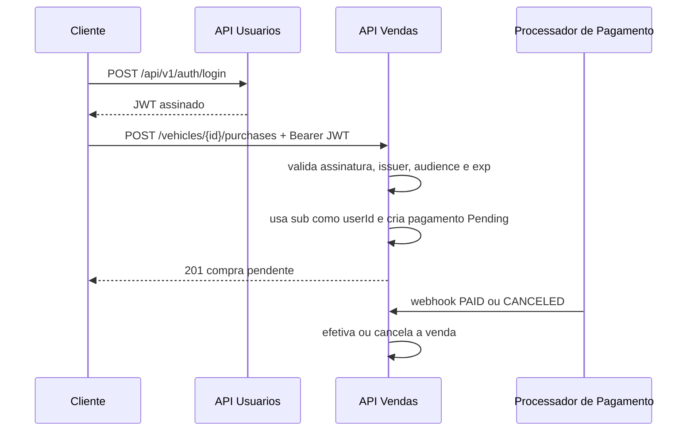

# Integração entre APIs

Falhas de token retornam 401. A API de Vendas não faz chamada síncrona à API de Usuarios para validar token; isso reduz acoplamento e mantém operação disponível enquanto o token for válido.
