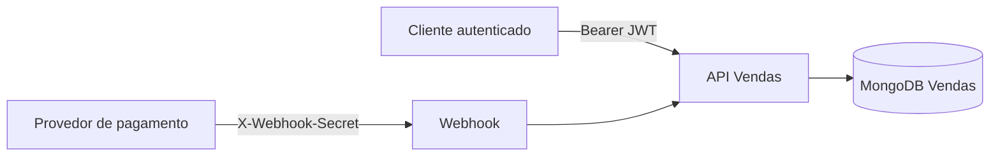
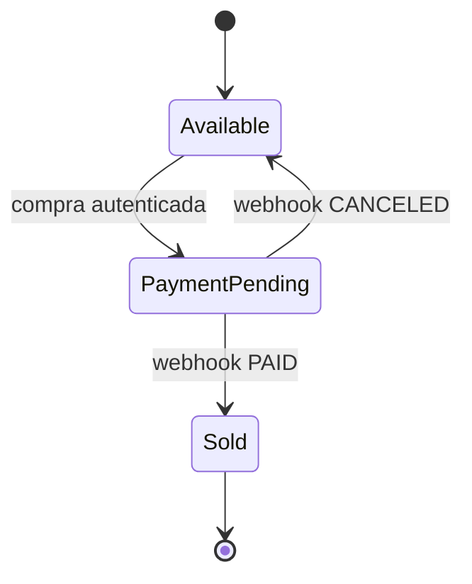

# API Design System — Vendas

## Propósito e fronteira

Esta API administra veículos e o ciclo transacional de compra. A identidade do comprador não é persistida como CPF: ela é o `sub` do JWT emitido pela API de Usuarios. A API não acessa o banco de Usuarios.



## Convenções

- Prefixo versionado: `/api/v1`.
- JSON em `camelCase`; datas em ISO 8601 UTC; valores monetários como `decimal`.
- Identificadores são strings.
- Respostas de erro usam `ProblemDetails`; validações de domínio retornam `ValidationProblem`.
- Paginação opcional: `page` (padrão 1) e `pageSize` (padrão 20, máximo 100).
- Todos os endpoints de veículos exigem `Authorization: Bearer <JWT>`.

## Recursos HTTP

| Método e rota | Finalidade | Resultado principal |
| --- | --- | --- |
| `POST /api/v1/vehicles` | Cadastra veículo | `201 Created` |
| `GET /api/v1/vehicles/{id}` | Consulta veículo | `200 OK` |
| `PUT /api/v1/vehicles/{id}` | Edita veículo disponível | `200 OK` |
| `GET /api/v1/vehicles/available` | Lista veículos disponíveis | `200 OK` |
| `GET /api/v1/vehicles/sold` | Lista veículos vendidos por preço crescente | `200 OK` |
| `POST /api/v1/vehicles/{id}/purchases` | Inicia compra do usuário autenticado | `201 Created` |
| `POST /api/v1/payments/webhook` | Processa retorno de pagamento | `204 No Content` |
| `GET /health/live` e `/health/ready` | Sondas de saúde | `200 OK` |

### Corpo de veículo

```json
{
  "brand": "Toyota",
  "model": "Corolla",
  "year": 2024,
  "color": "Prata",
  "price": 135000.00
}
```

### Compra e webhook

```json
{ "paymentCode": "pay-0001" }
```

O `userId` vem exclusivamente do claim `sub`. O webhook exige `X-Webhook-Secret` e recebe, por exemplo:

```json
{ "paymentCode": "pay-0001", "status": "PAID" }
```

Os únicos estados aceitos pelo webhook são `PAID` e `CANCELED`. A repetição do mesmo status é idempotente.

## Regras de estado



Somente veículos `Available` podem ser alterados ou reservados. Uma venda começa com pagamento `Pending`; só é considerada vendida após `PAID`.
