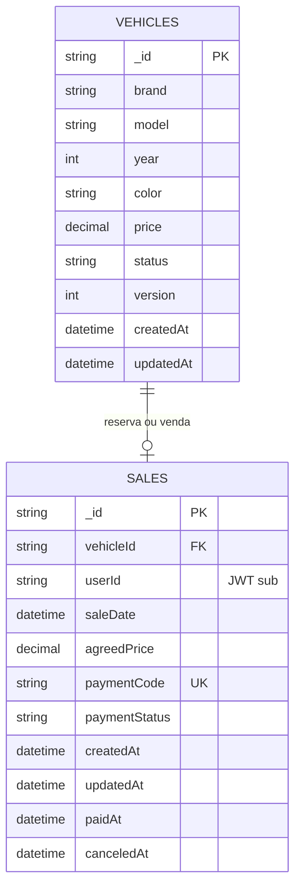

# Modelo de Dados — MongoDB de Vendas

O banco `revenda_vendas` é exclusivo desta API. A coleção de vendas guarda somente `userId`, correspondente ao claim `sub` do JWT; dados cadastrais e credenciais pertencem ao MongoDB de Usuarios.

## Coleções e índices

| Coleção | Índices | Regra preservada |
| --- | --- | --- |
| `vehicles` | `{ status: 1, price: 1, _id: 1 }` | Lista veículos disponíveis e vendidos por preço. |
| `sales` | único em `{ vehicleId: 1 }` | Um veículo não pode ter duas vendas. |
| `sales` | único em `{ paymentCode: 1 }` | O código de pagamento identifica uma única transação. |
| `sales` | `{ userId: 1, saleDate: -1 }` | Consulta futura por comprador. |

O campo `version` do veículo apoia atualização otimista. A reserva só ocorre quando o status ainda é `Available`; o processamento do pagamento só finaliza uma venda que ainda está `Pending`.
